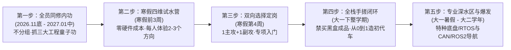

# 沈阳理工大学12人大一竞赛团队（车辆极客工作室）长期搭建与培养总纲

> [!IMPORTANT]
> **核心建队哲学：拒绝“赛事速成班”，走“长期主义硬核工程师养成路线”**
> 高校里90%的大一自建团队死于“急功近利”——刚组队就买淘宝成品小车、套现成代码、拼凑PPT去混低含金量奖状，大二大三真正拼硬实力时底层全是空的。
> 你们拥有 **车辆工程 + 装甲车辆工程 + 智能车辆工程** 的王牌跨专业底色，且具备**“不急于出成果、稳扎稳打做长线”**的定力。最佳策略是：**用整整大一学年把全员机电软底层内功打穿，先通识、再试水、后手搓闭环，到大二自然分化进入专业深水区，对各类高含金量赛事实施降维打击，并沉淀为沈理工可一届届传承的硬核技术工作室。**

---

## 一、 团队基因与主航道锁定

### 1.1 为什么你们这12人极具潜力？
* **专业互补闭环**：**装甲车辆工程**（特种越障机构、履带/悬挂构型、沈理工国防兵工特色）+ **车辆工程**（底盘机械结构、动力传动与车辆动力学）+ **智能车辆工程**（嵌入式电控、多传感器融合、视觉AI与自动驾驶算法），天然构成了“机械骨架 + 硬件神经 + 算法大脑”的完整闭环。
* **真实基础定位**：“多数零基础 + 少数有一点编程/单片机/建模/剪辑皮毛”。这意味着**绝不能让有一点基础的同学去备课当老师**（讲的人吃力、听的人迷茫），而要**让顶级免费开源网课当老师，有基础的同学当共学带头人，队长负责控节奏与收成品**。

### 1.2 全队锁死一口深井：【智能/特种无人车辆系统】
不要四处撒网，全队长期技术母体直接锚定 **“特种底盘结构 + 单片机/车规电控 + 视觉与激光感知导航”**：
* **门槛友好，上限极高**：大一花几百元从桌面级微缩循迹/越障小车起步即可跑通全流程；大二放大尺寸、换装特种摇臂履带或线控阿克曼底盘、搭载边缘计算板与激光雷达，就是准工业级特种无人平台。
* **一套核心技术，大二通吃四类顶级成果**（详见第五章“一鱼多吃”矩阵）。

---

## 二、 拒绝草率分组：三步漏斗式培养与定岗机制（大一上 — 寒假）

大一刚起步时，零基础组员不知道自己适合干什么，队长也还没看清11个人里谁是“三分钟热度”、谁是“坐得住冷板凳的实干派”。因此，**前期绝不盲目按名字填坑分组**，而是采用**“通识打底 → 零成本试水体验 → 双向选择定岗”**的漏斗机制：

### 2.1 第一步：全员“同修内功”通识期（2026年11月底 — 2027年1月中旬期末考）
**原则：不分组、不追赛、不拖累期末考！全员统一打牢车辆工程师通用的“四大童子功”。**

1. **编程真内功（拒绝复制粘贴代码）**
   * **全员死磕 C语言**：无论未来写单片机、做视觉算法还是搞数学建模，C语言都是共同母语。重点吃透**指针、结构体、数组、函数模块化编程**。要求全员在 **洛谷（Luogu）** 或校内OJ刷完入门前30道基础题，顺手了解 Python 基础语法。
2. **工程语言与制造公差思维**
   * 车辆类三大专业的看家本领。由懂一点建模的同学挑一个3小时的 `SolidWorks` 极简入门视频，全员装好软件、每人跟着画出一个简单零件（如轮毂或电机支架），并初步建立**“画出来的图怎么造出来”**的意识（了解3D打印、激光切割、钣金与CNC的工艺边界与公差概念）。
3. **让高数与线代“活过来”**
   * 拒绝重技轻理。平时共学时打通课本理论与工程实践的映射——例如：电机调速里的 **PID算法本质就是高数的微积分**，摄像头三维空间坐标变换与姿态解算**本质就是线性代数的矩阵乘法**。
4. **现代工程师协作习惯**
   * 全员学会用 **Markdown** 记录排错笔记，学会使用 **Git（Gitee/GitHub）** 管理版本，养成直接查阅英文芯片手册（Datasheet）和开源文档的习惯。

> [!TIP]
> **队长本阶段观察暗线（选拔未来核心骨干）**
> 12月中旬起全团停训，集体泡图书馆备战高数、工图、C语言期末考（保住高绩点是保研和长期做竞赛的底线）。在这一个半月里，队长重点观察：**谁每次小任务都按时交？谁遇到软件报错会自己搜教程解决？谁乐意在群里帮同伴答疑？** 这种人就是未来的核心组长人选。

---

### 2.2 第二步：寒假前3周“四大方向试水营”（2027年1月中下旬 — 2月上旬）
**原则：零硬件成本“尝鲜”，发给全员4个各需4~5小时的“新手村体验包”，每人至少挑 2~3 个亲手做完交作业，试出真兴趣与真天赋。**

| 体验包 | 测试维度 | 零成本试水任务内容 | 验收交付物 |
| :--- | :--- | :--- | :--- |
| **体验任务 A** （测机械结构天赋） | 空间想象力、制图耐心 | 跟着B站教程，用 `SolidWorks` 画出3个以上零件并完成**配合装配**（如一套齿轮啮合、阿克曼转向连杆或履带轮组）。 | 装配体截图 + 鼠标拖动机构运转录屏 |
| **体验任务 B** （测电控硬件天赋） | 电路逻辑、底层排错欲 | 不用买开发板，直接用网页端 **Wokwi 在线单片机仿真平台**连线LED、按键与电机写C代码；并在 **嘉立创EDA** 跟着临摹一张最小系统电源小板。 | Wokwi 仿真运行录屏 + 嘉立创EDA 3D预览图 |
| **体验任务 C** （测算法视觉天赋） | 代码抽象思维、数理逻辑 | 电脑配好 Python，用20行 `OpenCV` 代码调用笔记本摄像头实时框出画面里的红色物体；外加洛谷刷10道基础算法题。 | 摄像头实时框选录屏 + 洛谷AC通过截图 |
| **体验任务 D** （测产品统筹天赋） | 痛点提炼、审美与表达 | 找一个近3年“国创赛”或“挑战杯”智能装备类国金路演视频，写出1页纸拆解复盘（痛点、技术壁垒、商业逻辑），或用剪映卡点剪出30秒科技感短片。 | 1页复盘文档（Markdown/PDF）或30秒成片 |

---

### 2.3 第三步：寒假第4周“双向选择定岗”（实行“1主攻 + 1副攻”制）
前3周体验作业交齐后，组员试出了自己干哪一行最爽、最不觉得累，队长也看清了每个人的作品质量。此时召开线上定岗会，按 **“个人第一志愿 + 试水作品完成度 + 团队均衡”** 确立 **1主1副** 岗位（寒假后3周即可按主攻方向深入学习）：
* **为什么要“1主1副”？** 比如A同学主攻 **机械结构**、副攻 **三维渲染动画**；B同学主攻 **嵌入式电控**、副攻 **视觉串口通信/数模编程**。既有专精深度，又能在未来组队时互相补位，绝不因单人临时有事导致小队瘫痪。

---

## 三、 大一下学期核心工程训练：从0到1“手搓微缩智能车”

明年春季（2027年3月—6月），当别的功利团队忙着买淘宝成品车改个名字去水比赛时，你们关起门来做一件真正长功力的事——**将12人分为3个4人共学小组，严禁购买淘宝组装好的黑盒成品车，花一整学期亲手从0到1搓出一台桌面级智能小车！**

* **机械自己画**：哪怕只是最基础的四轮或小型履带底盘，每一块连接板、每一个电机固定座、每一处留给电控走线的过线孔，都自己拿游标卡尺量尺寸、建模、导出DXF切亚克力/碳板或3D打印。
* **电路自己画**：拒绝满车乱飞一碰就掉的杜邦线！自己用嘉立创EDA画原理图与双层PCB扩展板（稳压供电、单片机插座、电机驱动接口），亲手拿电烙铁把元器件焊上去、用万用表测短路。
* **代码自己敲**：从最底层配置定时器输出PWM波让轮子转起来，到读取正交编码器脉冲算出轮速，再到手写PID闭环控制与摄像头串口通信，一行行自己写、自己看波形调参。

> [!NOTE]
> **这一步的长期价值不可估量**
> 哪怕你们搓出来的第一代小车跑得歪歪扭扭、外观粗糙，但走完这一遍全栈闭环，你们12个人每一个人都彻底看懂了一台智能车辆“机械—硬件—软件”是如何咬合运转的。机械懂了给电控留安装空间，算法懂了单片机的算力边界，全队真正拥有了工程师全局观。

---

## 四、 四大技术方向“喂饭级”资源栈与深水区进阶图谱

从寒假后半段到大二学年，四个方向按 **“免费经典网课入门 → 初阶闭环指标 → 大二专业深水区”** 稳步推进：

### 4.1 机械与特种结构方向（装甲车辆 / 车辆工程主力）
* **必备软件**：`SolidWorks`、`AutoCAD`、3D打印切片软件（`Bambu Studio / Cura`）。
* **指定入门路径**：
  1. B站搜 **《SolidWorks 零基础十天入门》**（精练草图、拉伸切除、标准件库调用、配合装配、工程图导出）。
  2. **最快进阶法（拆解开源项目）**：去 **立创开源硬件平台（oshwhub.com）** 搜“智能车”“麦轮底盘”“履带底盘”，下载成熟开源三维模型拆开研究别人的电机固定结构、减震设计与公差留量。
* **初阶通关指标**：独立完成可搭载主控板、电池、4个编码器电机与相机支架的定制底盘装配体并打样拼装。
* **大二深水区护城河**：
  * **特种越障底盘研发**：摇臂履带复合底盘（装甲车辆王牌特色）、行星轮爬楼机构、主动/半主动悬挂系统、线控阿克曼转向几何设计；
  * **CAE工程仿真**：接触 `Adams` 多体动力学仿真与 `Ansys` 关键承力件有限元静力学/模态分析。

### 4.2 嵌入式与车规电控方向（智能车辆 / 车辆工程主力）
* **必备软硬件**：`Keil MDK` 或 `STM32CubeMX + CLion`、`嘉立创EDA专业版`；练手件选 `STM32F103C8T6核心板 + TB6612驱动 + 编码器减速电机`。
* **指定入门路径**：
  1. 单片机：B站搜 **《江协科技 STM32入门教程》**（重点吃透前7章：GPIO点灯、按键外部中断、定时器PWM控电机、USART串口收发、编码器接口测速）。
  2. 电路设计：B站搜 **《嘉立创EDA专业版 官方新手教程》**（利用嘉立创每月2次免费PCB打样券，零成本实操原理图到焊接全流程）。
* **初阶通关指标**：焊好自制电机驱动扩展板，调通位置式/增量式 **PID闭环定速与转向控制**，实现小车高速丝滑循迹与遇障平稳刹停。
* **大二深水区护城河**：
  * **车规通信与实时系统**：深入 `FreeRTOS` 多任务实时操作系统、**`CAN / CAN-FD 总线通信`**（现代汽车与高端机器人核心控制网络）；
  * **高阶控制与硬件**：MPU6050/IMU六轴姿态解算（卡尔曼/互补滤波）、无刷电机 `FOC` 矢量控制、四层PCB高速抗干扰与大功率电源管理（BMS基础）设计。

### 4.3 视觉算法、自动驾驶与数模方向（智能车辆 / 编程骨干主力）
* **必备工具**：`C++ / Python`、`OpenCV`、`PyTorch (YOLOv8/v11)`、`MATLAB`、`LaTeX`（数模论文排版）。
* **指定入门路径**：
  1. 算法底座：洛谷官方“入门与面试 / 算法基础题单”（精通数组、二分、贪心、DFS/BFS搜索、简单动态规划）。
  2. 计算机视觉：B站搜 **《OpenCV-Python 快速入门》**（二值化、滤波、透视变换提取车道线）+ **《YOLOv8 训练自己的数据集保姆级教程》**（标注识别锥桶、交通标志）。
* **初阶通关指标**：洛谷刷满60~100题；实现摄像头实时识别目标并计算中心像素偏差角，通过串口稳定发送给STM32执行转向。
* **大二深水区护城河**：
  * **自动驾驶软件栈**：熟练掌握 `Ubuntu Linux + ROS2（机器人操作系统）`、激光雷达与视觉 **SLAM 建图与自主路径规划（Nav2）**；
  * **边缘端部署与数模**：模型量化部署至 Jetson / RDK X5 等边缘算力板；同步掌握数学建模四大类模型（评价、预测、优化、物理机理建模）。

### 4.4 产品包装、工业渲染与统筹方向（剪辑 / 文案 / 队长兼任）
* **必备工具**：`Premiere / 剪映专业版`、`PowerPoint + iSlide`、`SolidWorks Visualize / Blender`（三维工业动画渲染）、`飞书知识库`。
* **指定入门路径**：
  1. 商业与逻辑：在B站精看10个近三年“中国国际大学生创新大赛”机器人/智能装备类金奖路演视频，提炼出“行业痛点→核心技术指标对比→样机实测→应用场景”标准框架。
  2. **视觉降维杀手锏**：学习 **《SolidWorks 爆炸视图动画 / Blender 硬表面工业渲染》**，将机械组画好的三维车体制作成炫酷的“零部件空中拆解与原理演示动画”。
* **核心产出指标**：沉淀高颜值路演PPT母版、高质量产品实测与三维渲染宣传片、专利交底书初稿及数模 `LaTeX` 标准排版模板。

---

## 五、 长期架构演进与大二“降维打击”成果转化

当大一底子打透后，大二开始进入收获期。12人工作室采取 **“平时按4条技术线深耕沉淀，赛时动态混编拆队出击”** 的矩阵运作模式：

### 5.1 “一鱼多吃”成果转化矩阵
依靠自研的【特种/智能无人车底盘与导航系统】这一核心资产，零重复劳动覆盖四大类竞赛与科研产出：
1. **单兵练手赛（大一下—大二）**：电控组与算法组个人报名 **蓝桥杯（单片机赛道 / C++或Python赛道）**、**CCCC天梯赛**，稳拿省一/国奖丰富个人简历。
2. **数学建模赛（大一9月 / 大二9月）**：12人刚好拆为 **4支标准3人队**（`1建模 + 1编程 + 1论文LaTeX排版`），冲击 **全国大学生数学建模竞赛（高教社杯）** 与美赛。
3. **硬核机器人与车辆工程赛（大一暑假—大二主力攻坚）**：拆为 **2~3支4人突击队**（每队 `1机械 + 2电控 + 1视觉/ROS`），出征 **全国大学生智能汽车竞赛**、**工程训练综合能力竞赛（工训赛）**、**睿抗机器人开发者大赛（RAICOM）**、**中国机器人及人工智能大赛**（智能驾驶/全地形无人车赛道）。
4. **顶级双创与知识产权（12人全团合体冲金）**：以 **大学生创新创业训练计划（大创省级/国家级立项）** 为依托，把历代自研样机升级包装，全员合体冲击 **中国国际大学生创新大赛（原互联网+）** 与 **“挑战杯”全国大学生课外学术科技作品竞赛（科技发明制作类）**，同步把独创机械机构与控制算法申请 **实用新型/发明专利** 与 **软件著作权**。

### 5.2 紧扣沈理工“兵工+高寒车辆”特色的王牌立项选题池
未来申报大创或打挑战杯/国创赛时，避开烂大街的通用选题，直接切入以下与你们三大专业100%契合的硬核方向：
* **选题一：《基于摇臂履带复合底盘的复杂环境多模态智能巡检无人车》**（装甲车辆特种越障结构 + 智能车辆红外/视觉融合避障，切入东北严寒变电站巡检、矿井巷道探测或国防特种侦察场景）。
* **选题二：《极端冰雪路面智能车辆防滑控制与视觉路况附着系数预警系统》**（立足东北高寒地域真实痛点，融合车辆动力学数学建模 + 轮速滑移率PID/模糊控制 + 冰雪路面视觉识别，极适合挑战杯科技发明）。
* **选题三：《面向新工科教学的开源模块化线控阿克曼底盘与ROS2算法验证平台》**（将你们自研练手的低成本线控小车标准化、开源化，既能打机器人赛，又能打国创赛新工科产业命题）。

### 5.3 三年长线成长全景路线图

| 学年阶段 | 核心战略定位 | 关键里程碑（Milestone） |
| :--- | :--- | :--- |
| **大一上** （2026.11 — 2027.01） | **通识筑基与保绩点** | 全员C语言入门30题 + SolidWorks初体验；期末全员高绩点不挂科；联系学院老师探路场地。 |
| **大一寒假** （2027.01 — 2027.02） | **四维试水与双向定岗** | 前3周完成ABCD零成本试水包；第4周确立“1主1副”方向；后3周完成各自方向基础网课。 |
| **大一下** （2027.03 — 2027.06） | **从0到1全栈手搓闭环** | 申报1~2项校/省级大创项目解决长期经费；3个4人组不买成品，独立画板、建模、敲代码搓出初代桌面小车；举办内部越障挑战赛。 |
| **大一暑假** （2027.07 — 2027.08） | **专业深水区跃迁** | 机械上特种履带/阿克曼结构，电控上RTOS与CAN总线，算法上Linux与ROS2；可派小队初试水智能车/机器人夏令营或省赛。 |
| **大二学年** （2027.09 — 2028.08） | **全面爆发与梯队传承** | 9月全员冲国赛数模；研发第二代工业级特种无人车样机，全面冲击智能车、工训赛、挑战杯与专利；吸纳2027级大一学弟学妹，完成工作室首届“传帮带”。 |

---

## 六、 12人队长实操管理手册（如何长期凝聚人心、不散伙、不内耗）

做长期主义团队最大的挑战是：**没有短期奖状刺激时，如何防止大家松懈掉队？** 作为队长，你自己不需要每个技术都比组员强，但必须牢牢抓好以下 **5条带队铁律**：

### 6.1 验收铁律：只收“成品演示”，绝不听“我看了多少集网课”
* 无论寒假还是平时，每1~2周固定周日晚8点开30~45分钟短会，**不谈空话，全员轮流投屏或摆出实物交作业**（哪怕只是点亮了一颗流水灯、画好了一个带轴承孔的轮子、跑通了20行OpenCV代码，也必须看到实际运行画面）。
* 当周卡壳交不上的同学，队长协调同方向骨干陪他排错补齐；若连续多次无故敷衍、确实对工程技术无感，可在学期末温和沟通转为外围成员，保证核心层永远同频纯粹。

### 6.2 用三大“非功利抓手”点燃长期造物热情
1. **用“内部极客造物节”代替外部水赛**：外部水赛全是填表写材料，消磨热情；内部挑战赛纯粹又好玩。比如寒假比拼“谁设计的3D打印桌面小摆件最巧妙”，大一下期末在实验室拿几本厚书搭斜坡，办一场**“首届工作室桌面爬坡越障王对决”**，赢的小组全队请吃烤肉。**工程师最持久的多巴胺，永远来自“我亲手造的东西跑起来了”。**
2. **把团队打造成“学业绩点互助共同体”**：长线团队最大的杀手是挂科焦虑。平时约着集体泡自习室，期末前3周全团无条件停训突击文化课——高数稳的给全队串讲微积分，工图强的辅导画图，C语言溜的帮大家查代码Bug。当你们12个人平均绩点排在全院前列时，学院领导和专业课老师会把你们当宝一样全力支持。
3. **共建一座“能传给下一届的技术Wiki遗产库”**：建立团队专属的 **飞书知识库** 与 **Git仓库**。规定每个人每攻克一个新模块（如“STM32编码器测速避坑指南”“嘉立创免费打样下单全流程”），就写一篇带图教程署上自己名字存进知识库。看着文档从0篇积累到上百篇，12名成员会产生强烈的**“工作室联合创始人”归属感**。

### 6.3 尽早绑定“指导老师 + 固定物理工位”（重中之重）
* 硬件团队没有固定插排和桌子，东西每天收进书包带回寝室，不出两个月必散。
* 队长可在期末前或大一下开学初，带2名骨干拿着这份《长期培养总纲》，主动拜访 **汽车与交通学院** 或 **装备工程学院** 负责智能车、方程式赛车、无人车科研或双创竞赛的老师（可请班导师引荐）。老师最喜欢**“大一成建制、不浮躁、肯踏实学底层技术且自我管理能力强”**的学生梯队，很容易就能帮你们协调出实验室的2~3张长桌，甚至借给你们往届淘汰的车架、电机和稳压电源练手。

### 6.4 透明可持续的“百元种子池 + 大创回血”经费机制
* **前期零负担起步**：通识期和寒假试水期采用在线仿真与软件建模，**0元花费**。
* **大一下手搓初代机阶段**：12人可每人小额众筹 **50~80元** 注入“团队种子硬件基金”（约600~960元），由专人在飞书表格记账公示，集中采购公用电烙铁、万用表、ST-Link下载器及3套百元级STM32电机基础散件，结合嘉立创免费PCB打样券即可跑通全流程。
* **中后期造血循环**：大一下3~4月立项校级/省级**大创项目**后，利用学校正规拨付的数千至上万元科研报销经费，采购激光雷达、边缘计算板（Jetson/RDK）、3D打印耗材与高精度传感器，所有大件设备登记为工作室公共传承资产。
