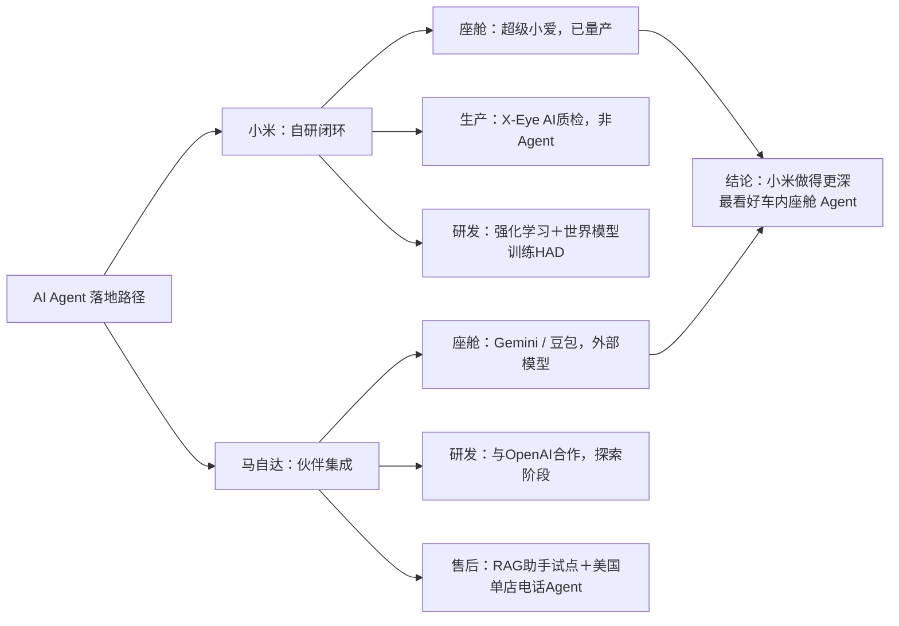

# AI Agent 在汽车企业的应用：小米汽车与马自达对比（第一周调查，约1500字正文＋表格与来源）

## Summary 摘要与概念界定

**一句话结论：小米做得更深。** 小米已把大模型能力量产装车、装进工厂质检，并用“强化学习＋世界模型”训练辅助驾驶，形成自研闭环；马自达的真实进展多为**与外部伙伴合作的单点应用**——座舱接入谷歌/豆包、研发与 OpenAI 做探索性合作、售后用 Databricks 做 RAG 助手，尚未见自研 Agent 平台或生产环节 Agent 的公开证据。

**概念纠错（全文统一口径）：** AI Agent 指能感知环境、自主规划、调用工具、分多步执行任务并根据反馈调整的系统。仅会聊天的语音助手、只做单一识别的 AI 算法、按固定程序动作的工业机器人，**都不自动等于 Agent**。下文每个案例都标注了严格程度：【接近Agent】【AI助手】【AI/自动化，非Agent】。

## Findings

### 小米（中国）3个场景

**1. 车内座舱——超级小爱【接近Agent，是小米最像 Agent 的量产案例】**
- 做什么：YU7 搭载超级小爱，端侧大模型融合位置、视觉、听觉多模态信息；五音区语音交互、全车多路同说与声纹识别；车外语音经声纹＋数字钥匙双重验证开前备箱；手机端一句话找车（给出车位编号与周边环境）；哨兵模式异常自动总结成一段话。后续 OTA 中又出现“主动智能”（按天气、PM2.5、空调效率主动建议）、一句话创建“小米超级任务”，以及“AI 智控”识别并操作屏幕、控制第三方应用完成任务——这几项具备规划＋调用工具＋多步执行的 Agent 特征。
- 效果：官方只给功能性表述，无独立的使用率/准确率数字，**不要编造**。注意官方脚注：部分功能需 OTA 实现。
- 来源：[S1][S5]

**2. 生产——北京工厂 X-Eye AI 质检【AI/自动化，非Agent，必须纠错】**
- 做什么：自研 X-Eye 智能质检系统对一体化压铸后地板拍 28 张 X 光片，由 AI 检测肉眼难见的内部缺陷；工厂有 700 多个机器人、200 多道关键工序自动化率 100%、每 76 秒一台车下线。
- 效果（可核查数字）：质检准确率**超过 99.9%**（人民日报引压铸车间负责人胡锴）；新华社称 AI 质检代替人眼、效率提高几十倍。
- 区别：X-Eye 是单一任务的感知/识别系统，机器人是固定程序自动化装备，**都不是能自主规划的 Agent**。把“700个机器人”说成“700个AI Agent”是典型错误。
- 来源：[S2][S3]

**3. 研发（含辅助驾驶训练）——Xiaomi HAD 增强版【研发侧的准Agent式训练】**
- 做什么：2025年11月发布 HAD 增强版，首次引入“强化学习＋世界模型”：用自建大规模 4D 数字资产库构建可变换环境的虚拟世界（高保真仿真引擎），系统在虚拟环境中反复试错、按“走对加分、走错扣分”的奖励机制自主学习驾驶策略，百路并行训练。此前量产版本用专业司机数据甄选的 1000 万 Clips 训练端到端大模型。
- 效果/投入（企业发布会口径，经车东西/汽车之家报道）：2025年在 AI 领域投资超过 70 亿元、智能驾驶研发团队超过 1800 人、设北京/上海/武汉三大研发中心；AEB 工作速度域拓展至前向 1–135 km/h、全系支持 20 项安全辅助。**无官方公布的事故率/接管率改善数字，不要外推。**
- 区别：这是用 Agent 式强化学习方法**训练**驾驶模型，不等于车已实现自动驾驶；小米自己在文末提示仍属辅助驾驶、驾驶员是主体。
- 来源：[S4][S1]
- 补充：小米汽车**销售/售后环节的 AI Agent/智能客服——未查到公开证据**（仅查到 App 内专属服务管家群、自助服务等人工/常规功能），报告中不要写。

### 马自达（日本）3个场景

**1. 车内座舱——分市场接入外部大模型【AI助手，非马自达自研Agent】**
- 全球市场：全新 MAZDA CX-5（美国、加拿大、欧洲、日本规格，带 Google built-in）2026年10月27日起支持 **Google Gemini**，经 Google Play 免费更新；自然对话即可设导航、按心情/目的找沿途停靠点、调空调（如说“车里冷、车窗起雾”）、按心情放音乐、Gemini Live 自由对话。官方脚注：仅部分车载功能受支持。
- 中国市场：长安马自达 EZ-60（2025上海车展首秀）全面接入**豆包大模型**（火山引擎/梧桐科技合作，始于2024年11月），专属 AI 助手可语音调用**超过 1,700 项功能**（出行、吃喝玩乐、聊天、车控“一语直达”），并构建人—车—环境跨模态框架（出行管家、娱乐助手、情感陪伴）。
- 区别：两个市场的模型都来自外部伙伴（谷歌、字节跳动），马自达做的是整车集成与 HMI（减少视线移动与操作负担），**不能写成“马自达自研大模型/Agent”**；其能力以对话＋功能调用为主，自主多步规划的证据弱于超级小爱。
- 来源：[S6][S7]

**2. 研发——与 OpenAI 的空气动力学/碰撞安全研究合作【探索性Agent应用，尚无成果数字】**
- 做什么：2026年11月3日 OpenAI 宣布新研究合作：OpenAI 研究与 Forward Deployed Engineering 团队与马自达空气动力学、碰撞安全工程师合作，用气流与结构行为仿真探索新车型设计改进，兼顾造型与成本；GPT-6 Astra（在 Codex 中）为工程师建多种新车头形状、仿真气流、筛选最有希望的方案（马自达首席工程师 Akihiro Nakata 语：探索和仿真数十种变体有助于理解哪些特征影响空气动力学、设计师还有多大造型自由度）。
- 效果：**官方明确说成果将在未来几个月陆续分享（"We'll share more progress and results in the coming months"）——目前无风阻改善、无开发周期缩短的官方数字，无量产车型采用的宣布。** 这是目前马自达最接近“工程 Agent”（生成方案→仿真→筛选迭代）的案例，但仍属研究阶段、工程师在环审核。
- 另有基础建设：Dell 2026年5月称马自达用 Dell PowerScale 统一模型化开发与 CAD 数据（容量约 4PB→10PB，2025年12月投运），为未来 AI/生成式 AI 数据湖打基础——属数据底座，不是 Agent 本身（可选引，见来源清单备注）。
- 来源：[S8]

**3. 售后——技术服务 GenAI 助手＋美国单店经销商电话 Agent【一弱一强，注意范围】**
- 总部侧（弱 Agent）：Databricks 2026年3月披露，马自达技术服务热线 GenAI 助手：RAG 连接大模型与服务信息文档库，并整合保修、召回、诊断码、维修/车辆历史；服务人员输入 VIN 后系统预载整车上下文，无预载时 AI agent 自行调用同一套工具查询。效果只有过程数字：**2 名数据科学家约 8 周做出可用概念、10 名服务人员试点**；官方称正在“探索”用 generative agents 支持技师/外勤工程师——即当前主体是 RAG 助手而非成熟 Agent。**该文未注明所属国家/市场，未给准确率或处理时长改善数字，不要补。**
- 经销商侧（真 Agent，但仅个案）：美国 Bob King Mazda（单店）部署 Spyne 的 Vini AI Service Inbound Agent，接听溢出与非营业时间的售后服务电话，实时识别服务意图、引导预约、自动回访/跟进。厂商自报效果：需求捕获提升 30%、服务预约提升 12%、线索资格率 40%、非营业时间覆盖 100%。**这是供应商案例数据、未经独立审计，且只是美国一家经销商，绝不能写成马自达全球/总部统一部署。**
- 来源：[S9][S10]
- 补充：马自达**生产环节的 AI Agent——未查到公开证据**。查到的只有自动化：如与矢崎合作的线束就近生产＋自动化（用于全新 CX-5，线束变体较上代减约 80%，马自达官网 2026-10-15）及混流产线 AGV——均为自动化/工艺再设计，官方无 AI Agent 表述，不要拔高。

### 对比表（2家×3场景）

| 场景 | 小米汽车 | 马自达 |
|---|---|---|
| 车内座舱 | 超级小爱：自研生态内端侧大模型，多模态、五音区、车外控车、哨兵总结、主动建议、一句话建任务、AI智控操作第三方应用【接近Agent，已量产】 | CX-5 接 Google Gemini（美/加/欧/日）、EZ-60 接豆包（中国，>1700项功能调用）【AI助手，外部模型，整车集成】 |
| 研发 | HAD增强版：强化学习＋世界模型在虚拟世界试错学策略；1000万Clips；2025 AI投资>70亿元、智驾团队>1800人（发布会口径）【已随OTA落地量产车】 | 与 OpenAI 研究合作：Astra in Codex 生成车头方案→气流仿真→筛选，兼碰撞安全；成果待未来数月公布【研究探索，无数字、无量产】 |
| 生产 / 售后（两家发力点不同） | 生产：X-Eye AI质检，28张X光片、准确率>99.9%，700+机器人关键工序自动化100%、76秒下线【AI质检+自动化，非Agent】；售后Agent：未查到公开证据 | 售后：总部技术服务 RAG 助手（2人8周、10人试点）；美国单店 Bob King Mazda 电话Agent（厂商自报需求捕获+30%、预约+12%）【总部弱、经销商个案强】；生产Agent：未查到公开证据 |

### 相同点
1. 都先落在“人机交互”和“知识/数据密集”环节：座舱对话控车、研发仿真、服务知识检索，而不是让 Agent 直接做安全攸关的整车决策。
2. 都靠大模型＋自有数据：小米用行车 Clips/车辆与生态数据，马自达用服务文档、车辆史与工程仿真数据；数据治理（权限、评测）都被强调。
3. 都保留人在环：小米反复提示辅助驾驶需驾驶员负责；马自达的工程输出由工程师审核、售后助手供服务人员使用。

### 不同点
1. **自研 vs 集成**：小米自研大模型/质检系统/智驾训练体系并打通人车家生态；马自达座舱、研发、售后分别用谷歌、豆包、OpenAI、Databricks、Spyne，属伙伴集成。
2. **落地深度**：小米三场景均已量产/投产且有可核查数字（99.9%、76秒、1000万Clips）；马自达除 EZ-60/CX-5 上车外，研发合作无成果数字、售后总部项目仅试点规模、经销商 Agent 仅单店。
3. **市场碎片化**：马自达座舱按市场换模型（中国豆包、欧美日 Gemini），体验与能力不统一；小米全球以自有体系为主（本文仅核查中国市场车型）。

### 结论：哪家更深、最看好哪个场景
- **更深：小米。** 理由：自研闭环＋三场景量产＋有公开量化指标；马自达目前是“点状合作”，深度取决于伙伴，且关键项目（OpenAI 合作）尚在出成果之前。
- **最看好：车内座舱 Agent。** 理由：①两家都已量产上车、用户可直接感知；②座舱任务（出行规划、跨应用操作、主动提醒、车家联动）天然是多步、需调用多工具的任务，最符合 Agent 定义，超级小爱的“AI智控＋超级任务”已给出范式；③相比之下，生产质检是单点识别、研发仿真仍需工程师审核、售后电话 Agent 价值明确但天花板在预约转化。风险提示：座舱 Agent 的主动执行必须受权限与驾驶安全约束，不能以“全自动”为卖点。

## 纠错清单（课程报告纠错表素材，均经原文核查）

| # | 容易说错/夸大的原说法 | 正确说法 | 核查依据 |
|---|---|---|---|
| 1 | “小米工厂700多个机器人都是AI Agent，工厂已无人化智能决策” | 700多个是自动化机器人；AI部分是单一任务的 X-Eye 质检（拍28张X光片识别缺陷，准确率>99.9%）。无证据表明机器人具备自主规划的Agent能力 | [S2][S3] |
| 2 | “马自达已用AI设计量产车，仿真时间/风阻降低约40%” | OpenAI官方只宣布研究合作、探索气流与结构仿真，明确说成果未来几个月再分享；官方无40%、无风阻改善数字、无量产采用宣布。网传40%出自无官方背书的二手站点，不可用 | [S8] |
| 3 | “马自达在全球统一部署了售后AI Agent，预约提升12%” | +12%是美国 Bob King Mazda **一家经销商**用 Spyne Vini AI 的厂商自报数据，未经独立审计；马自达总部项目只是技术服务 RAG 助手试点（10名测试人员） | [S10][S9] |
| 4 | “小米HAD是自动驾驶/可以脱手脱眼” | 小米在发布报道文末明确提示：现阶段仍属辅助驾驶，不能代替驾驶员，勿信“怎么开都撞不了”的夸大宣传 | [S4] |
| 5 | “马自达座舱大模型是自研的” | CX-5用 Google Gemini、EZ-60用豆包大模型（火山引擎），均为外部伙伴模型，马自达负责整车集成与HMI | [S6][S7] |
| 6 | “超级小爱/Gemini什么车载功能都能控制” | 小米部分功能需OTA实现；马自达官网脚注明确 Gemini 仅部分功能受支持、且仅限带 Google built-in 的美/加/欧/日规格 CX-5 | [S1][S6] |

## Could not verify 未查到公开证据（不编造）
- 小米汽车销售/售后环节的 AI Agent 或智能客服案例：未查到公开证据。
- 马自达生产环节的 AI Agent 案例：未查到公开证据（只有自动化/AGV/线束工艺再设计）。
- 马自达 OpenAI 合作的任何量化效果（风阻、周期、成本）：官方尚未公布。
- 马自达 Databricks 售后助手的所属市场、准确率、效率提升数字：原文未披露。
- Dell×马自达数据底座（容量4PB→10PB）为供应商新闻稿口径，正文未将其作为 Agent 成效使用：https://www.dell.com/en-us/newsroom/announcements/mazda-builds-ai-ready-data-foundation-with-dell-technologies

## Sources 来源清单（共10条；官网/官方/主流媒体≥3条：S2人民日报、S3新华社、S6马自达官网、S8 OpenAI官方）

- **[S1]** 《定价25.35万元起 小米YU7正式发布!》— 新能源汽车网（转载小米官方发布稿），2025-06-26发布/2025-06-27刊载，2026-11-28读取，verified live。URL: https://www.xnyauto.com/news/202506/59734.html — 支撑：超级小爱端侧大模型/五音区/车外控车/一句话找车、HAD 1000万Clips、部分功能需OTA。
- **[S2]** 《实体经济质量效益稳步提高》— 人民日报（peopleapp），页面未标明日期（报道2024年一季度经济），2026-11-28读取，verified live。URL: https://www.peopleapp.com/column/30044760540-500005378796 — 支撑：X-Eye自研、28张X光片、准确率超过99.9%。
- **[S3]** 《活力中国调研行丨76秒，下线一辆车！——在小米汽车工厂感悟分秒间的创新力》— 新华社稿，北京国际科技创新中心网（ncsti.gov.cn）转载，2025-06-19，2026-11-28读取，verified live。URL: https://www.ncsti.gov.cn/kjdt/ztbd/hlzgdyx/202506/t20250619_208168.html — 支撑：700+机器人、关键工序自动化100%、76秒下线、AI质检效率提高几十倍。
- **[S4]** 《技术投入超70亿，小米汽车发布辅助驾驶增强版，安全上限同步升级》— 车东西（汽车之家车家号转载），2025-11-21，2026-11-28读取，verified live。URL: https://chejiahao.m.autohome.com.cn/info/24159149 — 支撑：强化学习+世界模型训练机制、2025 AI投资>70亿元、团队>1800人、AEB 1–135km/h、文末辅助驾驶提示。
- **[S5]** 《大版本来袭：第一代小米SU7汽车OTA 1.16开推…》— IT之家，2026-05-13消息（页面日期以报道正文为准），2026-11-28读取，index。URL: https://www.ithome.com/0/950/030.htm — 支撑：超级小爱AI智控操作第三方应用、主动智能增强。
- **[S6]** "All-New MAZDA CX-5 with Google built-in now supports 'Google Gemini', AI Assistant" — Mazda Motor Corporation 官方新闻室（newsroom.mazda.com），2026-10-27，2026-11-28读取，verified live。URL: https://newsroom.mazda.com/en/publicity/release/2026/202610/261027a.html — 支撑：Gemini适用市场/车型、自然对话控车与导航、仅部分功能支持。
- **[S7]** 《长安马自达EZ-60全球首秀，接入豆包大模型》— IT168，2025-04-25，2026-11-28读取，verified live（该页自带内容未经本站证实声明，已与火山引擎车展报道交叉印证核心事实）。URL: https://software.it168.com/a2025/0425/6884/000006884652.shtml — 支撑：EZ-60接入豆包、AI助手调用>1700项功能、与火山引擎/梧桐科技合作背景。
- **[S8]** "Accelerating engineering for the physical world" — OpenAI 官方，2026-11-03，2026-11-28读取，verified live。URL: https://openai.com/index/accelerating-engineering-for-the-physical-world/ — 支撑：马自达×OpenAI研究合作范围（空气动力学/碰撞安全）、Astra in Codex工作方式、成果待公布。
- **[S9]** "From Legacy to Lakehouse: How Mazda Accelerated GenAI for Technical Service Operations" — Databricks 官方博客，2026-03-20，2026-11-28读取，verified live。URL: https://www.databricks.com/blog/legacy-lakehouse-how-mazda-accelerated-genai-technical-service-operations — 支撑：售后RAG助手架构、VIN预载/工具调用、2人8周、10人试点、正在探索generative agents。
- **[S10]** "How Bob King Mazda Unlocked 30% More Service Demand with Spyne Vini AI" — Spyne（供应商案例页），页面未标明日期，2026-11-28读取，index（正文数据见其案例页搜索索引，供应商自报、未经独立审计）。URL: https://spyne.ai/case-study/bob-king-mazda — 支撑：美国单店电话Agent做法与+30%/+12%/40%/100%四项厂商数据及其范围限定。
- 补充（生产自动化纠错用）：Mazda×Yazaki 官方PDF，2026-10-15，index。URL: https://newsroom.mazda.com/en/publicity/release/2026/202610/261015a.pdf — 线束就近生产+自动化、变体减约80%，无AI Agent表述。

---

## 附：一张图（流程图，说明核心结论）

> 图的含义：两家都从座舱等交互环节切入，但小米是自研并已量产的闭环，马自达主要是接入外部伙伴的单点应用，因此深度不同。
